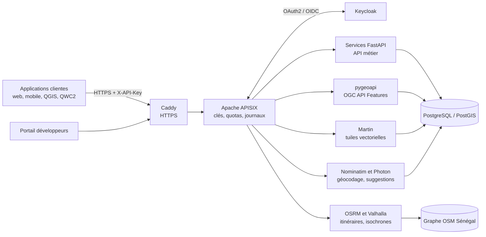

# Architecture

## Vue d'ensemble

## Composants

| Couche | Rôle | Logiciels (licence) |
|---|---|---|
| Passerelle d'API | Clés, quotas, journalisation | Apache APISIX (Apache-2.0), Kong OSS (Apache-2.0) |
| Identité | Comptes, OAuth2, rôles | Keycloak (Apache-2.0) |
| Services | Logique métier et OpenAPI | FastAPI (MIT), pygeoapi (MIT), pg_featureserv (Apache-2.0) |
| Moteurs spécialisés | Géocodage, routage, tuiles, rasters | Nominatim (GPL-2.0), Photon (Apache-2.0), OSRM (BSD-2), Valhalla (MIT), Martin (Apache-2.0), TiTiler (MIT) |
| Données | Stockage et traitements | PostgreSQL / PostGIS (PostgreSQL / GPL-2), GDAL (MIT) |
| Portail et documentation | Cette interface, spécifications | OpenAPI 3.1 (Apache-2.0), Redoc (MIT) |
| Exploitation | Déploiement, supervision | Docker Compose (Apache-2.0), Prometheus (Apache-2.0), Grafana (AGPL-3.0) |

## Principes

- **Open source et réversible** : chaque composant peut être remplacé ou installé chez le client (offre « Souverain »).
- **Standards** : REST/JSON, GeoJSON (RFC 7946), OpenAPI 3.1, OGC API Features et Tiles.
- **Coordonnées** : WGS 84 (EPSG:4326) par défaut ; UTM 28N (EPSG:32628) sur demande avec `crs=32628`.
- **Une base, des schémas** : un schéma PostGIS par module (`gindi`, `ref_admin`, `chealth`, `cartoscol`, `patribati`, `cegitcad`, `urba`, `wallu`, `naturasen`).
- **Sécurité** : clé d'API pour les données ouvertes ; jeton OAuth2 et rôles Keycloak pour les données restreintes (PatriBâti, CegitCAD+).
- **Versionnement** : préfixe `/v1/` ; une version majeure n'est retirée qu'après un préavis de 12 mois.

## Environnements

| Environnement | Adresse | Usage |
|---|---|---|
| Démonstration | GitHub Pages | Portail, démos sur les serveurs publics OSM, console simulée |
| Préproduction | api-preprod.cegitgroup.com | Tests internes et clients pilotes |
| Production | api.cegitgroup.com | Clients |
